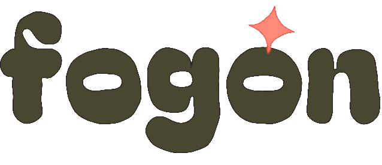

# Fogón

**Apps hechas en casa. Tu atención vale más que un anuncio.**

> Si las herramientas de hoy nos permiten hacer nuestras propias apps,
> ¿por qué seguir regalando nuestra información y nuestra atención
> a apps llenas de anuncios y micropagos?

## Manifiesto

Durante años, tener una app en el teléfono significó aceptar un trato que nadie firmó de verdad: la app es "gratis", pero la pagamos con nuestros datos, nuestro tiempo y nuestra paciencia. Anuncios entre pantalla y pantalla, funciones básicas detrás de un pago, permisos que no tienen nada que ver con lo que la app hace.

Eso ya no es la única opción.

En el fogón de la casa nunca se cocinó para vender. Se cocinaba para los de la casa, con lo que había, y siempre alcanzaba para uno más. **Fogón** quiere hacer lo mismo con el software: apps cocinadas en casa, con ayuda de la inteligencia artificial, para resolver una necesidad real. No buscan ganar dinero, y se comparten con quien llegue.

### No es la primera vez

Cada vez que la gente decidió hacer por sí misma lo que antes tenía que comprar, algo cambió:

- **La minga.** Desde antes de la Colonia, en los Andes los vecinos se juntan a trabajar gratis por algo de todos: levantar una casa, sacar una cosecha, abrir un camino. Nadie cobra; todos ganan. *(Mink'a, en quechua.)*
- **La rueca de Gandhi.** En la India colonial, el algodón salía hacia Inglaterra y regresaba convertido en tela que había que comprar. Gandhi propuso algo sencillo: hilar en casa. La rueca (*charkha*) pasó de ser un símbolo de pobreza a ser un símbolo de dignidad e independencia, sin violencia y al alcance de cualquiera.
- **Los pioneros de Rochdale.** En 1844, 28 trabajadores de Inglaterra, cansados de pagar caro por comida adulterada, abrieron su propia tienda con cuatro productos: harina, avena, azúcar y mantequilla. De ahí nacieron los principios cooperativos que hoy siguen millones de cooperativas en el mundo.
- **Linux.** En 1991, un estudiante finlandés anunció un sistema operativo que era "solo un pasatiempo, nada grande ni profesional". Hoy, gracias a miles de voluntarios, ese pasatiempo hace funcionar la mayoría de los servidores de internet y está en el corazón de Android.
- **Wikipedia.** Cientos de miles de voluntarios escribieron la enciclopedia más grande de la historia, sin un solo anuncio.

Todas tienen lo mismo en común: gente común, herramientas sencillas, trabajo compartido y nadie contra nadie. **Hoy, la herramienta sencilla es la inteligencia artificial.** Lo que antes exigía un equipo de ingenieros ahora lo puede cocinar una persona en su casa. Robin Sloan lo llamó *software casero*; Maggie Appleton, *desarrolladores descalzos*.

### Sin enemigos

Fogón no está *contra* nadie. No copiamos marcas, no atacamos empresas, no rompemos reglas. Solo encendemos el fogón y mostramos, con hechos, que existe otra manera. Quien quiera, se sienta a la mesa. Quien quiera, cocina con nosotros.

## Principios

1. **Nada de anuncios.** Ni banners, ni videos para "desbloquear".
2. **Nada de micropagos ni suscripciones.** La app está completa desde el primer día y es gratis para siempre.
3. **Tus datos son tuyos.** Sin analíticas, sin telemetría, sin SDKs de terceros. Todo se guarda en tu teléfono y puedes exportarlo cuando quieras en un formato abierto.
4. **Sin internet, si no hace falta.** Si la app no necesita red, ni siquiera pide el permiso.
5. **Solo los permisos indispensables.** Cada permiso se explica en el README de la app.
6. **Código abierto.** Cualquiera puede ver, estudiar, modificar y compartir el código (ver [Licencia](#licencia)).
7. **Transparencia sobre la IA.** Cada app dice qué herramienta de IA la hizo y cómo, para que cualquiera pueda repetirlo.
8. **Una persona la revisa.** La IA escribe el código; una persona decide qué se construye, lo prueba en un teléfono real y responde por él.
9. **Simple antes que completa.** Primero que haga bien una sola cosa.
10. **Hecha para durar.** Si este proyecto se abandona, el código sigue ahí y cualquiera puede continuarlo.
11. **Respeto ante todo.** Nombres e íconos propios, nada de imitar otras apps ni de hablar mal de nadie. Se cumplen las leyes y las licencias de todo lo que usamos.

## Apps

| App | Qué hace | Estado |
|-----|----------|--------|
| [El Forzudo](apps/forzudo/) | Registro de entrenos, rutinas, récords y rangos de fuerza (antes "Mi Gym") | En pruebas; se publica cuando tenga dibujos propios de los ejercicios |
| Alimentación | Calorías, macros y planes de comida | Siguiente |
| Gastos · El Ahorrador | Gastos, presupuestos y ahorro | Planeada |
| Hábitos · La Corredora | Hábitos, rachas y organizar el día | Planeada |
| Sueño · El Monje | Rutina y registro de sueño | Planeada |

Cada app vive en su propia carpeta dentro de `apps/`. Por ahora todas son para **Android**.

## Más información

- [docs/ANTECEDENTES.md](docs/ANTECEDENTES.md): los movimientos y las personas que inspiran este proyecto.
- [docs/LEGAL.md](docs/LEGAL.md): cómo hacemos esto sin meternos en problemas.
- [docs/IDENTIDAD.md](docs/IDENTIDAD.md): logo, colores, íconos y voz de las apps.
- [docs/TECNOLOGIA.md](docs/TECNOLOGIA.md): con qué se construyen las apps y por qué.
- [docs/ARQUITECTURA.md](docs/ARQUITECTURA.md): cómo están hechas por dentro (para quien quiera leer o cambiar el código, persona o IA). Cada app tiene además su propio `ARQUITECTURA.md`.

## Licencia

[GPL-3.0-or-later](LICENSE). Quien distribuya una versión modificada tiene que publicar también su código. Así nadie puede tomar una de estas apps, cerrarla y llenarla de anuncios. Sobre el alcance real de la licencia en código hecho con IA, ver [docs/LEGAL.md](docs/LEGAL.md).
