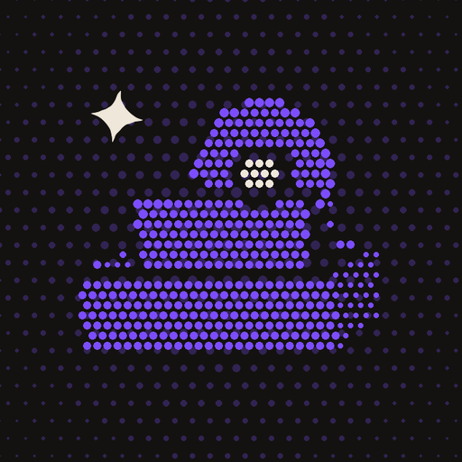

# Fogón

**Tuya desde el primer día.**

> ¿Por qué una app tendría que cobrarte cada mes,
> llenarse de anuncios o vigilar lo que haces?

## Manifiesto

Durante años, tener una app en el teléfono significó aceptar un trato que nadie firmó de verdad: la app es "gratis", pero la pagamos con nuestros datos, nuestro tiempo y nuestra paciencia.

Fogón es un estudio pequeño que hace apps para el día a día: entrenar, cuidar la plata, comer mejor y guardar lo que ves, lees y escuchas. Cada una con su propia cara y su propio carácter, cuidada hasta el último detalle.

### Sin enemigos

No copiamos marcas ni hablamos mal de nadie. Hacemos las cosas a nuestra manera y dejamos que las apps hablen solas.

### Lo que prometemos

- **Sin suscripciones:** la app viene completa, sin cobros cada mes.
- **Sin anuncios.**
- **Sin rastreo:** lo tuyo se queda en tu teléfono y lo exportas cuando quieras.

**Siempre alcanza para uno más.**

## Apps

| | App | Qué hace | Descargar |
|---|-----|----------|-----------|
|  | [El Forzudo](apps/forzudo/) | Tu cuaderno de entrenos: rutinas, descanso, récords y rangos de fuerza | [Última versión](https://github.com/fogonapps/el-forzudo/releases/latest) |
|  | [El Ahorrador](apps/ahorrador/) | Gastos, presupuesto (sobres, 50/30/20, kakeibo), tarjeta de crédito, metas y pagos fijos, sin internet | [Última versión](https://github.com/fogonapps/el-ahorrador/releases/latest) |
|  | [La Cucha](apps/cucha/) | Calorías, recetas colombianas, menú de la semana y lista de mercado | [Última versión](https://github.com/fogonapps/la-cucha/releases/latest) |
|  | [El Cajón](apps/cajon/) | Películas, series, animes, libros y música: tu nota, tu diario, tus listas y recomendaciones | [Última versión](https://github.com/fogonapps/el-cajon/releases/latest) |

Para Android. Con [Obtainium](https://github.com/ImranR98/Obtainium) las actualizaciones llegan solas: Añadir aplicación → pegar el enlace del repo de la app (por ejemplo `https://github.com/fogonapps/el-cajon`).

## Contacto

Fallos o ideas: desde la app («Reportar un fallo o sugerir algo»), en [GitHub](https://github.com/fogonapps/fogon/issues) o a **fogonapps@gmail.com**.

## Licencia

[GPL-3.0-or-later](LICENSE).
