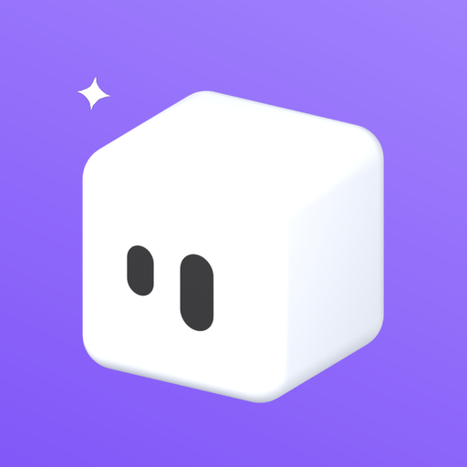

# El Cajón · Fogón

Todo lo que ves, lees y escuchas en un mismo lugar: películas, series, animes, libros, álbumes y artistas, con tu nota, tu reseña y tu diario. Sin anuncios ni rastreo. Su personaje es una cajita curiosa que pone cara según lo que estás viendo o escuchando.

- Descargar: [fogonapps/el-cajon](https://github.com/fogonapps/el-cajon/releases/latest) (con [Obtainium](https://github.com/ImranR98/Obtainium) llegan solas las actualizaciones: pegar `https://github.com/fogonapps/el-cajon`).
- Novedades de cada versión: en las [versiones de El Cajón](https://github.com/fogonapps/el-cajon/releases).

## Qué hace

Lo que antes se anotaba a mano en tablas de cine, lectura y música, más lo de las apps de diario de cine, libros y discos, en una sola app.

- **Todo en un cajón:** películas, series, animes, libros y álbumes, cada uno con portada (se puede cambiar o subir una imagen propia), año, director/autor/artista, géneros y sinopsis de su fuente (lo oficial no se edita). Filtros por tipo y estado, búsqueda y orden (recientes, nota, año, A–Z).
- **Buscar y agregar:** libros en Open Library y discos y artistas en MusicBrainz (sin clave); películas, series y animes en TMDB con la clave gratuita de cada persona. Lo que no está en ninguna fuente se agrega a mano.
- **Estados:** por ver/leer/escuchar, viendo/leyendo/escuchando, visto/leído/escuchado, abandonado. Con las fechas de empezar y terminar.
- **Nota en estrellas** de media en media, me gusta, reseña (solo de la persona: la app nunca la escribe), datos curiosos, etiquetas propias y géneros como etiquetas (tocar una busca lo que la lleva) y episodios favoritos.
- **Diario:** cada vez que se ve, lee o escucha algo, con fecha, nota de ese día, si fue otra vez y unas palabras.
- **La nota del público** junto a la tuya: la de TMDB (de 0 a 10), Open Library o MusicBrainz (de 0 a 5), con cuántos votaron.
- **Progreso:** páginas (libros) y cada canción de un álbum con su nota y su corazón.
- **Inicio y apartados:** el Inicio dice todo lo del cajón (películas, series y animes vistos, álbumes escuchados, artistas, libros leídos) y cada cosa tiene su apartado: Cine, Música y Libros, con sus cifras del año, lo que está en curso y su cajón con filtros.
- **Buscador** como el de una app de música: arriba Todo, Películas, Series, Animes, Música o Libros; abajo el mejor resultado (un artista con su foto) y los grupos, cada uno con "Ver más". Géneros para tocar en cada sección (también los del anime), y la ficha completa de un artista, escritor o director antes de guardarlo.
- **Artistas** con su foto (Wikimedia Commons, por Wikidata, con autor y licencia) y su discografía de MusicBrainz para sumar discos con un toque; los artistas de los álbumes se suman solos.
- **Escritores y directores**, como los artistas: escritores de Open Library (con su foto de Wikimedia Commons) y sus libros; directores de TMDB (con su foto) y lo que dirigieron. Van en los apartados de Libros y de Cine.
- **Listas propias** de cualquier tipo, con ranking si se quiere y para reordenar. Las cuatro favoritas en el perfil.
- **Tus cifras:** lo terminado en el año (o siempre), horas de cine y de series, páginas, canciones, entradas del diario, racha, notas por estrellas, meses, géneros y creadores. **Retos** del año por tipo.
- **Compartir** una obra o una lista como imagen (portada, estrellas, reseña).
- **Traer de otras apps:** el historial de Letterboxd (ZIP o CSV) y la biblioteca de Goodreads (CSV), sin repetir lo que ya está.
- **Teléfono y PC:** sincronización opcional con un Gist secreto de la cuenta de GitHub de la persona. La versión de PC leerá el mismo archivo.
- **Widget:** lo terminado este año y lo que está en curso.
- **Respaldo** en JSON y el respaldo de todo Fogón. **Apariencia** como en todas las apps (Grafito, Vinilo, Claro y Contraste). **En español e inglés.**

- **Enlaces** a Spotify, Wikipedia, IMDb, Letterboxd, Goodreads y más desde cada ficha y perfil.
- **Elegir varios** (mantener presionado) para borrar, cambiar el estado o sumar a una lista.
- **Elegir otra imagen** (portada, fondo o foto) entre las de sus fuentes, o subir una propia.
- **Reportar un fallo o sugerir algo** desde Ajustes.

- **La música que escuchas:** lo que suena en Spotify, YouTube Music o cualquier app llega a "Escuchado hace poco", o se agrega solo; también desde Spotify (Premium) o tu historial de Spotify.

- **Para ti:** recomendaciones de películas, series, animes, artistas y libros desde lo que te gustó, y tus pendientes más tuyos.
- **Tu perfil:** tu foto arriba en el Inicio; una biografía cultural, con la letra que elijas para tu nombre y contadores que se tocan: foto, portada, nombre de usuario, biografía y enlaces; tus favoritos (película, serie, anime, álbum, libro, artista), la obra que te marcó y tu descubrimiento del momento; tus cuatro favoritas, las cifras que elijas, tu evolución por año, tus listas y tu diario; quién vería cada cosa (privado, amigos, público) y cómo se vería desde afuera; compartirlo como imagen.
- **Tus gustos:** cuéntale qué te gusta y qué no (categorías, géneros y lo que te gusta de lo más visto, escuchado y leído); en "Para ti", mantén presionado para decir "no me gusta", "no me interesa", "no recomendar esto" o "nada de este género o artista"; y mira y corrige lo que aprendió de ti.

## Permisos (y por qué)

| Permiso | Para qué |
|---------|----------|
| Internet | Buscar y traer los datos, portadas y fotos (TMDB, Open Library, MusicBrainz, Cover Art Archive, Wikidata y Wikimedia Commons) y, si se activa, sincronizar con GitHub. |
| Acceso a notificaciones (opcional) | Solo si se activa "Anotar lo que escucho": Android lo pide para dejar ver qué canción suena en otras apps (Spotify, YouTube Music…). El Cajón no lee las notificaciones: solo artista, álbum y canción de lo que suena, y lo guarda en el teléfono. |
| Datos de las apps de Fogón | Que otra app de Fogón (firmada con la misma llave) guarde o recupere los datos de El Cajón en el respaldo de todo Fogón. Ninguna otra app puede usarlo. |

- **Lo que sale del teléfono:** el texto que se busca (a la fuente elegida) y, con la sincronización, el cajón entero a un Gist secreto de la propia cuenta. Nada más.
- **Lo que escuchas** (con "Anotar lo que escucho", Spotify o su historial) se guarda en el teléfono (`files/escuchas.json`) y, desde la 1.12, viaja con el respaldo y con la sincronización al Gist propio, donde se une con lo del otro equipo.
- **Las claves** (TMDB, el token de GitHub y el acceso a Spotify) quedan cifradas con el Keystore de Android y no van en el respaldo ni en el Gist.
- **Sin copias automáticas a la nube de Google.**

## Créditos

- Películas, series y animes: [TMDB](https://www.themoviedb.org/), con la clave de cada persona. El Cajón usa TMDB y su API, pero no está respaldada, certificada ni aprobada por TMDB.
- Libros: [Open Library](https://openlibrary.org/) (Internet Archive).
- Música: [MusicBrainz](https://musicbrainz.org/) (núcleo de datos CC0) y carátulas del [Cover Art Archive](https://coverartarchive.org/).
- Fotos de artistas: [Wikimedia Commons](https://commons.wikimedia.org/), encontradas por [Wikidata](https://www.wikidata.org/); cada una con su autor y licencia en la ficha del artista.
- Portadas: Coil, Apache 2.0.
