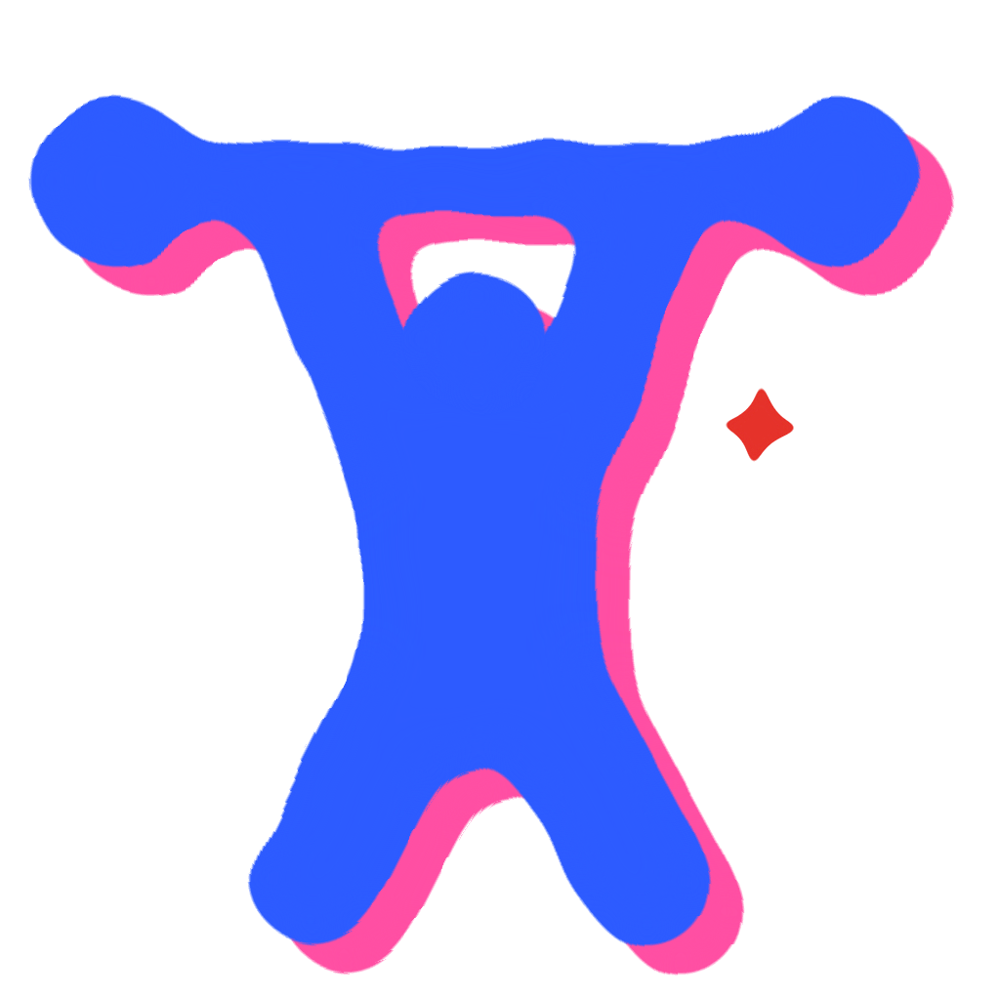

# El Forzudo · Fogón

<p align="center"></p>

Registro de entrenos de gimnasio. Sin anuncios, sin rastreo, gratis de verdad. La app y su personaje se llaman igual: **El Forzudo**. Hasta la versión 1.2.1 se llamó **Mi Gym** (`io.github.fogonapps.migym`).

- Cómo está hecha por dentro: [`ARQUITECTURA.md`](ARQUITECTURA.md).
- Cómo cambiar cosas y sacar versiones nuevas: [`GUIA.md`](GUIA.md).
- Descargar: [GitHub Releases](https://github.com/fogonapps/fogon/releases) (con [Obtainium](https://github.com/ImranR98/Obtainium) llegan solas las actualizaciones). F-Droid, más adelante.

## Qué hace

- **Entreno en vivo:**
  - lo que hiciste la vez anterior;
  - metas automáticas ("sube el peso hoy", "busca +1 rep");
  - descanso con aviso y vibración;
  - récords marcados con la chispa;
  - aviso cuando llevas 3 sesiones sin progresar, con alternativas;
  - cancelar o terminar en cualquier momento, también desde la barra del entreno en curso.
- **6 programas listos** (de 3 a 6 días) y **editor de rutinas** (series, repeticiones, descanso, orden, cambiar o quitar ejercicios).
- **65 ejercicios** con técnica y enlace a videos; 57 con lámina de inicio y final.
- **Rangos de fuerza** de Hierro a Diamante, por ejercicio, por músculo y general, con mapa del cuerpo. La tabla es propia, calibrada con OpenPowerlifting (ver [`ESTANDARES.md`](ESTANDARES.md)). También las series por músculo en la semana.
- **Constancia:**
  - racha de semanas;
  - semanas del mes;
  - mapa anual de días entrenados.
- **Peso corporal** con gráfica.
- **Tus datos son tuyos:**
  - se guardan en el teléfono;
  - exportar e importar en JSON;
  - sincronización opcional con un Gist secreto de tu propia cuenta de GitHub.
- **Apariencia:** todo se imprime como una riso (dos tintas, la segunda corrida). Cinco estilos (Noche, Riso, Rebelde, Chicle, Contraste); en cada uno se eligen el papel, las tintas, cuánto se corre la tinta, el adorno y todos los colores, además de textura, esquinas, transparencia, tamaño de letra, menos movimiento y más contraste.
- **En español e inglés:** sigue el idioma del teléfono, y se puede cambiar en Perfil → Idioma.
- **Reportar un fallo o sugerir algo** desde Perfil: abre GitHub o el correo con el mensaje listo.

## Permisos (y por qué)

| Permiso | Para qué |
|---------|----------|
| Internet | Solo si activas la sincronización con tu Gist. Sin ella, la app no se conecta a nada. |
| Notificaciones | El aviso de "descanso terminado". Se pide al empezar el primer entreno. |
| Alarmas exactas | Que ese aviso llegue a tiempo. Si lo niegas, se usa una alarma aproximada. |
| Vibración | Al marcar una serie y al terminar el descanso. |

- **Sin copias automáticas a la nube de Google:** solo se copian los entrenos al pasar los datos a un teléfono nuevo.
- **El token de GitHub va cifrado** con una llave del Keystore de Android y nunca sale del teléfono.

## Viene de la versión web

Es la reescritura en Kotlin de la versión web (repo `1015Angel/My-gym`). Usa el mismo formato de datos (v2), así que:
- se conecta al mismo Gist y trae el historial;
- lee los respaldos `.json` de la versión web.

La lógica (rangos, rachas, metas, estancamiento, unión con la nube) se comprobó contra la versión web original con datos de prueba: **0 diferencias** (ver `herramientas/`). Desde la 1.2 la tabla de fuerza es distinta a la de la web, así que los rangos ya no coinciden con ella. La lógica sigue siendo la misma.

## Compilar

Requiere JDK 21 y el SDK de Android (`local.properties` con `sdk.dir`).

```
JAVA_HOME=/usr/lib/jvm/java-21-openjdk ./gradlew :apps:forzudo:assembleDebug
```

El APK queda en `apps/forzudo/build/outputs/apk/debug/`.

Para la versión firmada y cómo llega al teléfono, ver [`docs/PUBLICAR.md`](../../docs/PUBLICAR.md).

## Versiones

| Versión | Fecha | Qué cambió |
|---------|-------|------------|
| 1.0 | 2026-10-11 | Reescritura en Kotlin con todo lo de la web. |
| 1.1 | 2026-10-11 | Tutorial, manifiesto en la app, racha automática, muñequitos en la barra. Primera versión firmada con la llave de Fogón. |
| 1.1.1 | 2026-10-13 | El campo de peso se vacía al guardar. |
| 1.2 | 2026-10-18 | Tabla de fuerza propia de Fogón, calibrada con OpenPowerlifting (dominio público), en lugar de la de strengthlevel.com. Ya no muestra "más fuerte que X %". Los rangos de todos cambian. |
| 1.2.1 | 2026-10-18 | Pantalla de Licencias con el texto completo de cada una (Acerca de → Licencias). Aviso de salud en Acerca de y como paso del tutorial ("Escucha a tu cuerpo"). |
| 1.3 | 2026-10-18 | **Nuevo nombre: El Forzudo** (identificador `io.github.fogonapps.forzudo`). Para Android es una app nueva: los datos se pasan exportando el respaldo en Mi Gym e importándolo aquí (probado en el emulador con un respaldo real de Mi Gym). La sincronización con el Gist sigue usando el mismo archivo `mi-gym-datos.json`. |
| 1.4 | 2026-10-18 | Láminas riso propias en lugar de las fotos (54 ejercicios; los otros 11 quedan sin dibujo por ahora). Licencias: Everkinetic CC BY-SA 4.0. Tope de 10 MB al importar y sin tráfico sin cifrar. Preguntas frecuentes dentro de la app (Perfil). Probada en el emulador el 20-10-2026: instalada encima de la 1.3 sin perder datos, láminas completas en el detalle, ejercicio sin lámina con su ícono, preguntas frecuentes y 0 cierres inesperados. |
| 1.4.1 | 2026-10-20 | Lámina de la sentadilla búlgara (55 ejercicios con lámina; quedan 10 sin dibujo). La búsqueda de ejercicios ya no depende de las tildes ("jalon" encuentra "Jalón"). Probada en el emulador encima de la 1.4: lámina nueva en el entreno, búsqueda y 0 cierres inesperados. |
| 1.4.2 | 2026-10-21 | Primera versión reproducible (lista para F-Droid): el APK ya no lleva el commit dentro. El tutorial dice que los datos también se pueden guardar en tu propia nube. Ficha para F-Droid en `fastlane/`. Probada en el emulador instalada desde cero: tutorial, importar respaldo, entreno con láminas, rangos y 0 cierres inesperados. |
| 1.4.3 | 2026-10-21 | Láminas de aperturas y press de hombro en máquina, de dibujos de Everkinetic que están en Wikimedia Commons (57 ejercicios con lámina; quedan 8 con su ícono). Probada en el emulador encima de la 1.4.2: lámina de aperturas en el entreno y 0 cierres inesperados. |
| 1.5 | 2026-10-21 | **Inglés**, además del español: sigue el idioma del teléfono y se cambia en Perfil → Idioma (textos en `strings.xml`, datos en `assets/datos/en/textos.json`). **Cancelar o terminar el entreno** en cualquier momento: botones arriba del entreno y una X en la barra del entreno en curso; sin series marcadas, cancelar no pregunta y Terminar ofrece cancelar. **Reportar un fallo o sugerir algo** (Perfil), por GitHub. Enlace al código en Acerca de. Probada en el emulador encima de la 1.4.3: inglés por defecto (emulador en inglés), cambio a español y de vuelta sin reiniciar, cancelar y terminar en sus 4 casos, reportes, Acerca de y Manifiesto en inglés, 0 cierres inesperados. La lógica sigue igual a la web (comparación completa: solo difieren los rangos, como desde la 1.2). |
| 1.5.1 | 2026-10-21 | Reportes también por correo, a fogonapps@gmail.com. Contacto en los README. Probada en el emulador: aparecen los dos botones de envío, 0 cierres inesperados. |
| 1.6 | 2026-10-21 | **Estilo de noche:** fondo oscuro con luces violeta y azul, tarjetas de vidrio, botones en píldora y acento lima (ver `docs/IDENTIDAD.md` → Estilo de noche). Las láminas van sobre tarjetas de papel. La app queda siempre de noche. Probada en el emulador en inglés y en español: todas las pestañas, entreno, tutorial y 0 cierres inesperados. |
| 1.7 | 2026-10-21 | **Apariencia** (Perfil → Apariencia): cinco estilos (Noche, Riso, Rebelde, Aura y Contraste); en cada uno se cambian todos los colores (fondo, tarjetas, letras, acento, degradados, números, bordes), la transparencia, la textura y las esquinas, y cada uno trae los suyos por defecto. Comodidad: tamaño de letra, menos movimiento y más contraste. **Menos genérico** (ver `docs/IDENTIDAD.md` → ADN visual): Inicio con la racha en un número gigante, etiquetas técnicas y líneas; Rangos con el nombre del rango gigante; el descanso como un medidor con marcas; muñequitos y personaje con borde de calcomanía (antes el azul se perdía sobre la luz azul). Probada en el emulador con 104 entrenos de prueba en los cinco estilos y en Apariencia, y la versión firmada instalada encima de la 1.6. Reproducible desde la etiqueta pública `forzudo-v1.7`. |
| 1.8 | 2026-10-23 | **Sistema riso** (Angel rechazó la 1.7 por genérica; ver `docs/IDENTIDAD.md` → Sistema riso): todo se imprime con un papel y dos tintas, la segunda corrida. Íconos gordos y en dos tintas (la barra deja los muñequitos y usa íconos, con la pestaña activa en una mancha de tinta), trama de puntos en lugar de orbes y degradados, la racha y el rango impresos en dos pasadas, sello de goma para la mejor racha, bordes de tinta en tarjetas y botones. Apariencia: Chicle reemplaza a Aura; papel, primera y segunda tinta en muestras, corrimiento de la tinta y adorno; los colores cambiados en la 1.7 vuelven a los del estilo. Probada en el emulador en los cinco estilos (Inicio, Entrenar, Rangos, Perfil, Apariencia y tutorial). |

**1.1.1** se probó completa en el emulador con la versión firmada:
- tutorial y registro de peso;
- entreno con descanso, con la notificación en segundo plano;
- resumen;
- los datos siguen tras cerrar la app a la fuerza;
- exportar, e importar un respaldo de la web (104 entrenos, rachas y rangos iguales a la web);
- actualizar encima sin perder datos;
- modo oscuro.

Se instaló en el teléfono de Angel (Galaxy S24, Android 16) el 2026-10-13 y arranca sin errores. La app web vieja (`com.angel.migym`) se desinstaló; no tenía datos.

## Preguntas frecuentes

También están dentro de la app (Perfil → Preguntas frecuentes, en `ui/Pantallas.kt`). Si cambia una, se cambia en los dos lados.


**¿Por qué los dibujos de los ejercicios solo tienen figuras de hombre?**
Los dibujos salen de Everkinetic, un banco de ilustraciones de ejercicios con licencia libre, y todas sus figuras son de hombre. No encontramos ilustraciones libres con figuras de mujer. Probamos generarlas con inteligencia artificial, pero no quedaban al mismo nivel ni en el mismo estilo, y preferimos no poner algo a medias. El ejercicio y el músculo que trabaja son los mismos para todas las personas. Si alguien quiere dibujar las versiones de mujer con licencia libre, son bienvenidas.

**¿Por qué algunos ejercicios no tienen dibujo?**
Usamos solo dibujos con licencia clara, y para esos ejercicios todavía no hay uno. Van a llegar en una actualización.

**¿Qué significan los colores?**
Cada grupo muscular tiene su color, el mismo en toda la app: la mancha del dibujo marca el músculo que trabaja. La sombra del dibujo dice la zona: rosa para el tren superior, amarillo para los brazos y azul para las piernas.

**¿Por qué no hay fotos?**
Las fotos que usaba la app venían de un banco que se presentaba como libre, pero en realidad eran fotos sacadas de internet sin permiso de sus dueños. Por eso se cambiaron por dibujos con licencia clara.

**¿De dónde salen los rangos de fuerza?**
De una tabla propia de Fogón, calibrada con resultados reales de competencias de powerlifting (OpenPowerlifting, de dominio público). Están explicados en [`ESTANDARES.md`](ESTANDARES.md).

**¿Mis datos salen del teléfono?**
No. Todo se guarda en el teléfono. Solo si conectas tu propio GitHub, los entrenos se copian a un archivo privado de tu cuenta.

**¿Por qué antes se llamaba Mi Gym?**
Hasta la versión 1.2.1 se llamó así. Desde la 1.3 lleva el nombre de su personaje, El Forzudo, como todas las apps de Fogón.

## Pendiente


- **Probar en el teléfono real la sincronización con el Gist** (con el token de verdad).
- Dibujo para los 8 ejercicios sin lámina (lista y motivo de cada uno en `herramientas/laminas/ejercicios.py`). Everkinetic no tiene uno que sirva ni en su repositorio ni en Wikimedia Commons, y los hechos con IA no quedaron al nivel.

## Contacto

Fallos o ideas: desde la app (Perfil → Reportar un fallo o sugerir algo), en [GitHub](https://github.com/fogonapps/fogon/issues) o a **fogonapps@gmail.com**.

## Créditos

- Estándares de fuerza: modelo de Fogón con datos de [OpenPowerlifting](https://www.openpowerlifting.org) (dominio público).
- Dibujos de los ejercicios: [Everkinetic](https://github.com/everkinetic/data) (CC BY-SA 4.0; aperturas y press de hombro en máquina desde [Wikimedia Commons](https://commons.wikimedia.org/wiki/Category:Weight_training_diagrams), CC BY-SA 3.0), pasados a lámina riso por Fogón; las láminas también son CC BY-SA 4.0. Hasta la 1.3 la app usaba fotos de free-exercise-db, que no eran libres (ver `docs/LEGAL.md` §6).
- Modelo muscular: [react-body-highlighter](https://github.com/giavinh79/react-body-highlighter) (MIT, © 2020 GV79), que tomó el dibujo de [react-native-body-highlighter](https://github.com/HichamELBSI/react-native-body-highlighter) (MIT, © 2022 ELABBASSI Hicham).
- Letras: Bagel Fat One y Anton (SIL Open Font License).
- Licencia del código: GPL-3.0 o posterior.
